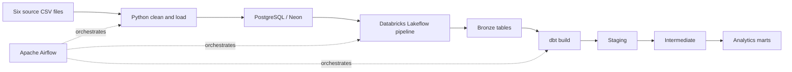
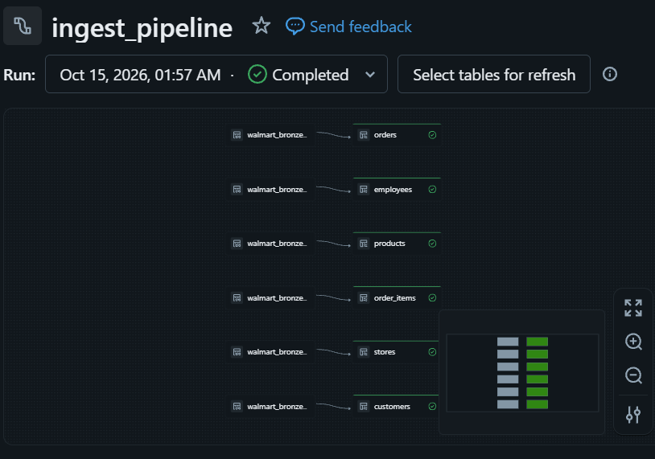
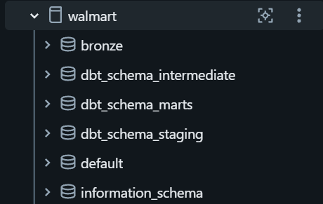
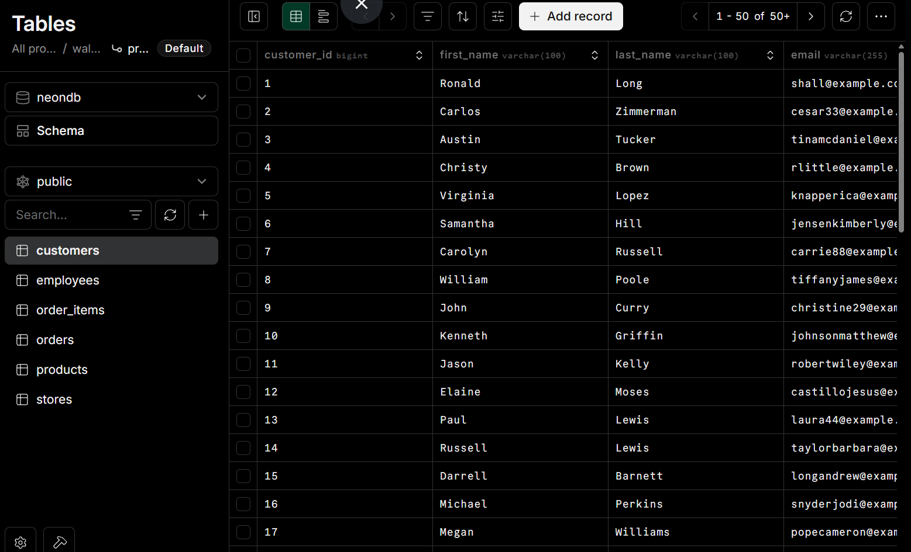

# Walmart Data Engineering

An end-to-end ELT pipeline for a simulated Walmart retail dataset, built with Python, PostgreSQL (Neon), Databricks Lakeflow, dbt Core, and Apache Airflow.

The project demonstrates how raw retail data can be ingested, cleaned, orchestrated, transformed, and organized into analytics-ready datasets.

## Business Problem

Retail businesses generate data across multiple operational systems, including customers, products, stores, and sales transactions. Analyzing these datasets independently makes it difficult to obtain a consistent view of sales performance and customer activity.

This project simulates a retail data engineering workflow that consolidates six related source datasets into a centralized analytics environment. It establishes a structured data pipeline that prepares operational data for downstream analysis.

### Solution

The pipeline uses Python to clean and load source CSV files into PostgreSQL hosted on Neon. Databricks Lakeflow ingests the source tables into a Bronze layer, and dbt Core transforms the ingested data into staging, intermediate, and analytics mart models. Apache Airflow orchestrates the workflow.

The resulting data model is designed to support analytical use cases such as:

- Analyzing sales and order totals.
- Exploring customer purchasing activity.
- Analyzing product sales performance.
- Comparing store-level sales performance.

These are intended analytical use cases; the project does not claim to implement a separate business intelligence dashboard.

## Architecture

The pipeline follows an ELT architecture with an initial Python data-cleaning step.



### Pipeline workflow

The Airflow DAG is named `elt_pipeline` and contains three main tasks executed in sequence:

1. **`run_script`** — cleans the six raw CSV files, writes cleaned copies, and inserts records into the configured PostgreSQL database.
2. **`ingest_neon_to_delta`** — runs the configured Databricks pipeline to ingest the PostgreSQL source tables into the `walmart.bronze` catalog/schema.
3. **`run_dbt`** — executes `dbt build` against Databricks, building the configured dbt models and running their applicable tests.

The DAG uses an `@once` schedule with catchup disabled. After its initial scheduled run, it can be triggered manually through the Airflow interface.

## Technologies and Why They Were Used

| Technology | Purpose |
|---|---|
| Python | Cleans source data, normalizes recognized data types, removes duplicate rows, and loads records into PostgreSQL. |
| pandas | Supports CSV reading and data-cleaning operations. |
| PostgreSQL | Provides a relational source database with tables, primary keys, and foreign-key constraints. |
| Neon | Hosts the PostgreSQL source database. |
| Databricks Lakeflow | Ingests the source tables into the Databricks environment. |
| Databricks | Provides the environment for storing and transforming analytical datasets. |
| dbt Core | Organizes SQL transformations into reusable models, manages model dependencies, and runs data tests. |
| Apache Airflow | Orchestrates the ingestion and transformation tasks through a DAG. |
| Docker Compose | Runs the local Airflow development environment and its configured services. |
| uv | Manages the root Python project's dependencies and environment. |
| Git and GitHub | Provide source control and project documentation. |

## Final Pipeline Results

The following screenshots document successful pipeline execution.

### Airflow orchestration


### Databricks ingestion



### Database and schema results

| Databricks dbt schemas | Neon source tables |
|---|---|
|  |  |

These screenshots are captured results, not live dashboard embeds.

## Data Sources and Models

### Source datasets

The six CSV files are located under `walmart_dataset/data/raw/`:

- `customers.csv`
- `employees.csv`
- `orders.csv`
- `order_items.csv`
- `products.csv`
- `stores.csv`

The PostgreSQL source schema and foreign-key definitions are maintained in [`walmart_dataset/ddl/walmart_schemas.sql`](walmart_dataset/ddl/walmart_schemas.sql).

### Python data cleaning

Before loading, the Python ingestion scripts:

- Trim text values.
- Normalize recognized integer, decimal, timestamp, and boolean columns.
- Remove duplicate rows.
- Write cleaned CSV copies.
- Load the cleaned records into the six PostgreSQL tables.

### Databricks and dbt layers

The source tables are ingested into the `walmart.bronze` catalog/schema. dbt uses this Bronze layer as its source for downstream transformations.

| Layer | Models | Materialization |
|---|---|---|
| Bronze | Six ingested source tables | Managed by the Databricks ingestion pipeline |
| Staging | Customers, orders, order items, products, stores | Incremental |
| Intermediate | Enriched order items, order totals | Tables |
| Marts | Customer, product, and store dimensions; order and sales facts | Tables |

The dbt project defines uniqueness, not-null, and relationship tests for selected model keys.

**Current scope:** The `employees` dataset is ingested into Bronze, but there is no employees staging SQL model yet.

## Getting Started

### Prerequisites

Before running the project, ensure you have:

- Python 3.13 or later.
- [uv](https://docs.astral.sh/uv/) installed.
- Docker and Docker Compose.
- A reachable PostgreSQL-compatible source database.
- A Databricks workspace with the configured Lakeflow pipeline.
- Databricks credentials and the connection settings required by the dbt profile.

You will also need network access from the relevant services to the configured databases and Databricks workspace.

### 1. Clone the repository

```bash
git clone https://github.com/AshrafJB2/walmart-data-engineering.git
cd walmart-data-engineering
```

### 2. Install Python dependencies

From the repository root, run:

```bash
uv sync
```

This installs the dependencies defined by the root Python project.

### 3. Configure the PostgreSQL source database

Create a private `.env` file in the repository root containing your PostgreSQL connection settings:

```env
POSTGRES_HOST=your-database-host
POSTGRES_PORT=5432
POSTGRES_DB=your-database
POSTGRES_USER=your-user
POSTGRES_PASSWORD=your-password
```

Replace the placeholder values with your actual database credentials.

Ensure the source database and required tables are available before running the ingestion script.

**Security:** Never commit `.env` files, passwords, API tokens, or screenshots containing credentials. The current Airflow Dockerfile copies the root `.env` into its image during the build, so do not build or distribute an image containing real credentials.

### 4. Configure Databricks

Configure your Databricks workspace and the Lakeflow pipeline to ingest the six PostgreSQL source tables into the expected `walmart.bronze` catalog/schema.

Confirm that:

- The Databricks pipeline is configured to connect to the source database.
- The required destination catalog and schema are available.
- The pipeline can successfully ingest the source tables.
- The credentials and connection settings are valid.

### 5. Configure dbt

The dbt project is located in `walmart_project/`.

Configure the dbt profile with valid Databricks connection settings, including the workspace host, HTTP path, and authentication token. The checked-in profile contains placeholder values, so replace them with your own configuration before running dbt.

For detailed profile setup and dbt commands, see [`walmart_project/README.md`](walmart_project/README.md).

### 6. Configure and start Airflow

The Airflow environment is defined in `airflow/docker-compose.yaml`, with the corresponding image configuration in `airflow/Dockerfile`.

Follow [`airflow/README.md`](airflow/README.md) for the exact service startup commands and connection configuration.

Before running the complete DAG, configure the Airflow `databricks_default` connection and provide the valid Databricks connection settings required by the pipeline and dbt profile.

### 7. Run the ELT pipeline

Once the source database, Databricks pipeline, dbt profile, and Airflow connections are configured:

1. Start the Airflow environment using the documented setup instructions.
2. Open the Airflow web interface.
3. Locate the `elt_pipeline` DAG.
4. Trigger the DAG manually.
5. Verify that `run_script`, `ingest_neon_to_delta`, and `run_dbt` complete successfully.
6. Inspect the resulting Bronze tables, dbt models, and test results.

Because the Python loaders use plain `INSERT` statements, a repeated run against already populated tables may fail with duplicate primary-key errors. Use a fresh or appropriately reset source database for a clean initial run.

## Repository Structure

```text
walmart-data-engineering/
├── airflow/
│   ├── dags/
│   │   └── walmart_elt_orchestration.py
│   ├── docker-compose.yaml
│   ├── Dockerfile
│   └── README.md
├── ingestion/
│   ├── src/
│   └── README.md
├── images/
│   ├── airflow_pipeline.png
│   ├── databricks_ingest_pipeline.png
│   ├── delta_database_schemas.png
│   └── neon_postgress_tables.png
├── walmart_dataset/
│   ├── data/
│   │   └── raw/
│   └── ddl/
│       └── walmart_schemas.sql
├── walmart_project/
│   ├── models/
│   │   ├── staging/
│   │   ├── intermediate/
│   │   └── marts/
│   └── README.md
├── data_modelisation/
└── README.md
```

For component-specific details, see:

- [Airflow setup and orchestration](airflow/README.md)
- [Python ingestion and cleaning](ingestion/README.md)
- [dbt models, profiles, and commands](walmart_project/README.md)

## Project Goals

This project was built to practice and demonstrate core data engineering skills:

- Building a multi-stage data ingestion pipeline.
- Working with relational databases and structured source data.
- Implementing data cleaning and type normalization in Python.
- Ingesting source tables into a Databricks environment.
- Developing modular SQL transformations with dbt.
- Applying data quality tests.
- Orchestrating pipeline tasks with Apache Airflow.
- Documenting the architecture, setup, execution, and operational limitations of an end-to-end data pipeline.
