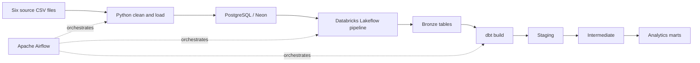

# Walmart Data Engineering

An end-to-end ELT pipeline for a simulated Walmart retail dataset. Apache Airflow
orchestrates Python ingestion, a Databricks Lakeflow pipeline, and dbt
transformations in Databricks.

## Pipeline



The Airflow DAG is named `elt_pipeline`. It runs the tasks in this order:

1. `run_script` cleans the raw CSVs and inserts their records into the configured
   PostgreSQL database.
2. `ingest_neon_to_delta` runs the configured Databricks pipeline to copy the
   source tables into the `walmart.bronze` catalog/schema.
3. `run_dbt` runs `dbt build` against the Databricks profile.

The DAG uses the `@once` schedule with catchup disabled. After the initial
scheduled run, trigger it manually from Airflow when you want to run it again.

## Final pipeline result

The screenshots below capture a successful Airflow run and a completed
Databricks ingestion pipeline.


Additional screenshots show the resulting Databricks schemas and the source
tables in Neon:

| Databricks dbt schemas | Neon source tables |
| --- | --- |
|  |  |

These are captured results, not live dashboard embeds.

## Data and models

The source files are under `walmart_dataset/data/raw/`:

`customers.csv`, `employees.csv`, `orders.csv`, `order_items.csv`,
`products.csv`, and `stores.csv`.

Python trims text, normalizes recognized integer/decimal/timestamp/boolean
columns, removes duplicate rows, and writes cleaned CSV copies before loading
the six tables. The source relational schema and foreign keys are defined in
[`walmart_dataset/ddl/walmart_schemas.sql`](walmart_dataset/ddl/walmart_schemas.sql).

dbt reads the six tables from the `walmart.bronze` source. The implemented
models are:

| Layer | Models | Materialization |
| --- | --- | --- |
| Staging | customers, orders, order items, products, stores | Incremental |
| Intermediate | enriched order items, order totals | Tables |
| Marts | customer/product/store dimensions, order/sales facts | Tables |

The dbt project also defines uniqueness, not-null, and relationship tests for
selected model keys. The `employees` source is ingested into bronze, but there
is currently no employees staging SQL model.

## Requirements and setup

- Python 3.13 or later and [uv](https://docs.astral.sh/uv/)
- Docker Compose
- A reachable PostgreSQL-compatible source database
- A Databricks workspace with the configured Lakeflow pipeline and dbt access

Install the root Python project from the repository root:

```powershell
uv sync
```

Create a private root `.env` containing the source database connection values
used by ingestion:

```env
POSTGRES_HOST=your-database-host
POSTGRES_PORT=5432
POSTGRES_DB=your-database
POSTGRES_USER=your-user
POSTGRES_PASSWORD=your-password
```

Do not commit `.env` or put credentials in screenshots. The current Airflow
Dockerfile copies the root `.env` into its image during build, so do not publish
an image built with real credentials.

For the Airflow container environment and service startup, see
[`airflow/README.md`](airflow/README.md). For source cleaning and load behavior,
see [`ingestion/README.md`](ingestion/README.md). For dbt profiles, models, and
commands, see [`walmart_project/README.md`](walmart_project/README.md).

## Repository layout

```text
airflow/
  dags/walmart_elt_orchestration.py   # elt_pipeline DAG
  docker-compose.yaml                 # Local Airflow services
  Dockerfile                          # Airflow image with ingestion code
ingestion/src/                         # CSV cleaning, database access, loaders
images/                                # Pipeline and database screenshots
walmart_dataset/
  data/raw/                            # Six CSV source files
  ddl/walmart_schemas.sql              # PostgreSQL source schema
walmart_project/
  models/staging/                      # Incremental source models
  models/intermediate/                  # Enriched and aggregated models
  models/marts/                        # Dimensions and facts
data_modelisation/                     # Saved dbt/schema result exports
```

## Operational notes

- The Python loaders use plain `INSERT` statements; they do not upsert or remove
  previously loaded rows. Re-running against already populated tables can
  encounter duplicate primary keys.
- The cleaned CSV output path is `/opt/airflow/data/cleaned`, as used by the
  Airflow task/container setup.
- Configure Airflow's `databricks_default` connection and provide valid
  Databricks `host`, `http_path`, and `token` settings for the dbt profile before
  triggering the complete DAG. The checked-in profile currently contains
  placeholder values.
- `airflow/docker-compose.yaml` is intended for local development, not
  production.
