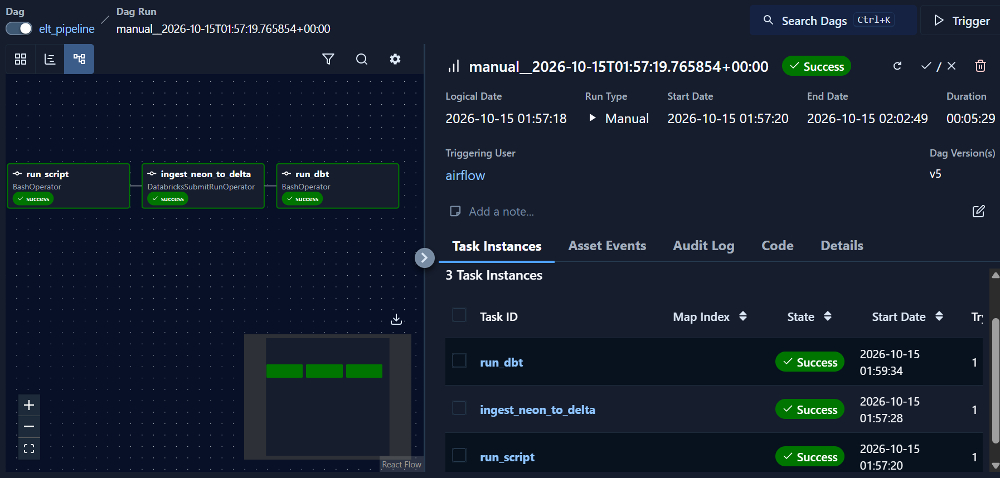

# Airflow orchestration

This folder contains the local Docker Compose setup and the `elt_pipeline` DAG.
The DAG runs Python ingestion, a Databricks Lakeflow pipeline, then dbt:

```text
run_script -> ingest_neon_to_delta -> run_dbt
```

It is configured with `schedule="@once"` and `catchup=False`. Trigger a run
manually from the Airflow UI after the initial scheduled run.

## Prerequisites and configuration

- Docker Desktop with Docker Compose
- A root-level `.env` with the `POSTGRES_HOST`, `POSTGRES_PORT`,
  `POSTGRES_DB`, `POSTGRES_USER`, and `POSTGRES_PASSWORD` values needed by the
  ingestion task. The database must be reachable from the Airflow container.
- An `airflow/.env` file, which Compose loads into its containers. It can
  provide local Airflow overrides and the `DATABRICKS_HOST`,
  `DATABRICKS_HTTP_PATH`, and `DATABRICKS_TOKEN` values if the dbt profile uses
  `env_var()` for its credentials.
- A Databricks `databricks_default` Airflow connection, a configured
  Databricks pipeline, and a valid dbt profile. See
  [`../walmart_project/README.md`](../walmart_project/README.md) for dbt
  profile setup.

Keep both `.env` files private. The Airflow Dockerfile currently copies the
root `.env` into the image at build time; do not publish an image built with
real credentials. The Compose file has local-development defaults for the
Airflow web user; set a private password before exposing the UI beyond your
machine.

## Start the stack

Run from the repository root:

```powershell
docker compose -f airflow/docker-compose.yaml up --build -d
docker compose -f airflow/docker-compose.yaml ps
```

Open [http://localhost:8080](http://localhost:8080) and sign in with the
configured Airflow web user. In Airflow, confirm that `databricks_default`
exists and points to the correct workspace, then trigger `elt_pipeline`.

The `ingest_neon_to_delta` task submits pipeline ID
`c81ff899-bbee-4627-b077-014d8b43d913`; update the DAG if using a different
Databricks pipeline. The dbt task runs:

```text
dbt build --profiles-dir /opt/airflow/project/walmart_project
```

Review the logs for all three tasks to confirm completion. The screenshot is a
captured successful run:



## Logs and shutdown

```powershell
docker compose -f airflow/docker-compose.yaml logs -f airflow-scheduler
docker compose -f airflow/docker-compose.yaml down
```

The Compose configuration is intended for local development, not production.
